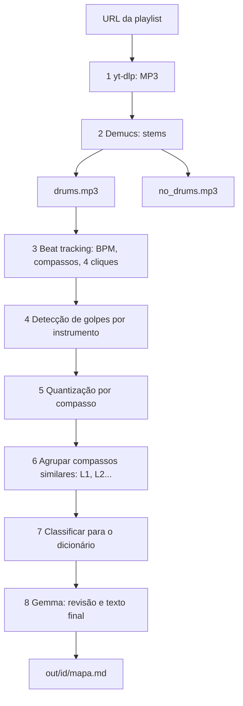
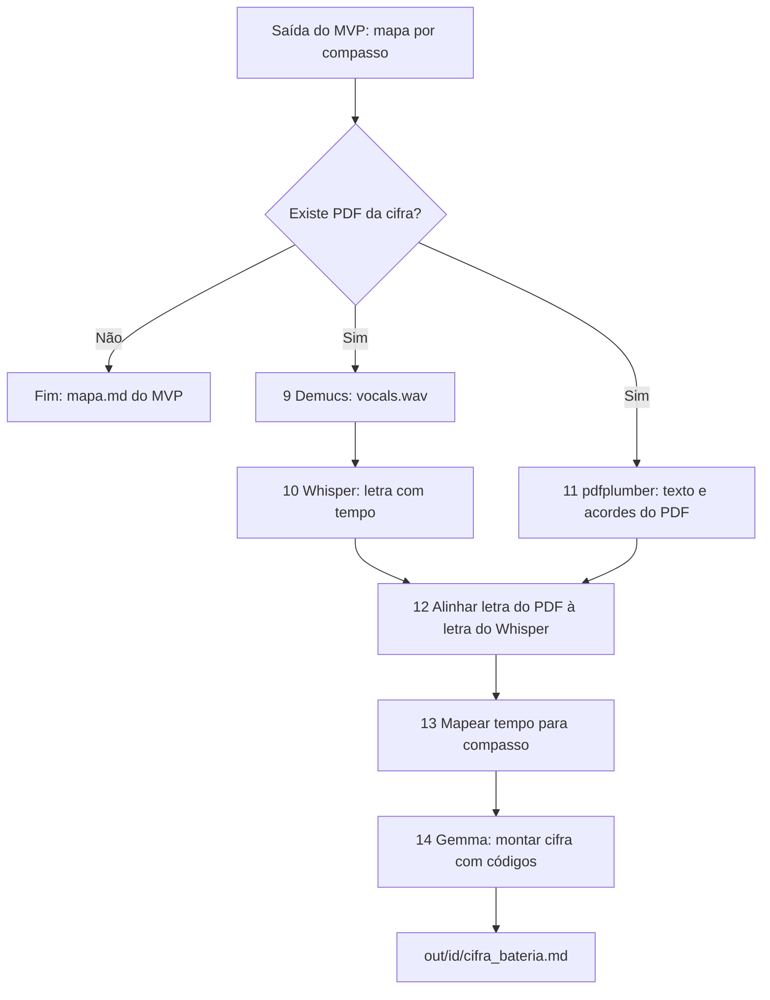

# Pipeline Música → Mapa de Bateria (MVP)

## Objetivo

A partir de uma URL de playlist (YouTube/YT Music, uso pessoal), gerar para cada música:

1. MP3 original
2. MP3 **sem bateria** (backing track)
3. MP3 com **só bateria**
4. **Mapa de bateria em Markdown**, por compasso, usando o dicionário de códigos

Fora do MVP (fase 2): PDF da cifra, alinhamento com a letra, Whisper.

## Premissas

- Python local (CLI + scripts), Windows, GPU RTX 3060 (12 GB)
- Gemma-4-12B-it-qat-q4_0.gguf via llama.cpp, só para texto (não ouve áudio), porta 11435
- Cada etapa é independente e tem cache em disco por música (`work/<id>/`)
- Pastas de trabalho: `work/<id>/` e `out/<id>/`

## Fluxo



## Etapas

| # | Etapa | Ferramenta | Entrada → Saída |
| --- | --- | --- | --- |
| 1 | Download | yt-dlp + ffmpeg | URL → `work/<id>/original.mp3` |
| 2 | Separação | Demucs (htdemucs, 4 stems) | mp3 → `drums.wav`, `no_drums.wav` (soma de bass+other+vocals) |
| 3 | Tempo e compassos | madmom ou librosa | drums → BPM, downbeats, 4/4, offset da contagem inicial |
| 4 | Golpes | Opção A: ADTLib/Omnizart; Opção B: filtros por banda de frequência + onsets | drums → eventos (tempo, instrumento, intensidade) |
| 5 | Quantização | Código Python | eventos → grade de 16 passos por compasso |
| 6 | Agrupamento | Similaridade entre compassos | compassos → padrões (L1, L2...) e sequência por compasso |
| 7 | Dicionário | Tabela de regras (YAML) | padrão → código (`[L-h]`, `[L-cbha]`...) |
| 8 | Revisão e texto | Gemma via llama.cpp | JSON de padrões → `mapa.md` |

## Dicionário (regras iniciais)

| Código | Regra de detecção |
| --- | --- |
| `[S]` | Nenhum evento no compasso |
| `[L-h]` | Só hi-hat fechado |
| `[L-abh]` | Aro + bumbo + hi-hat fechado |
| `[L-cbha]` | Caixa + bumbo + hi-hat semi-aberto |
| `[L-cbrc]` | Caixa + bumbo + cúpula do ride |
| `[CR-cs]` | Crescendo de caixa + surdo em colcheias |
| `[V-ct1s]` | Virada caixa → tom 1 → surdo |
| `[BQ-bpa1]` | Bumbo + ataque 1 seco |

Regras ficam em `config/dicionario.yaml`, editáveis. Se houver mais de um padrão do mesmo tipo: `L1-h`, `L2-h`.

## Formato de saída (`mapa.md`)

```
# Exemplo Rock | BPM 120 | 4/4 | Início: 4 cliques (h)
| Compasso | Código |
|---|---|
| 1-4 | [L-h] |
| 5-8 | [L-cbha] |
```

## Exemplo Cifra

L-cbh
Eu tentei fugir de tudo
          BQ-bpa1           S                     V-cs
Mas o tempo...     (silêncio: só a voz) ...não parou!

## Riscos

- Tons, surdo, aro e hi-hat aberto vs. fechado são imprecisos: validar à mão nas primeiras músicas e ajustar o YAML.
- Os códigos mais subjetivos (`semi-aberto`, `cúpula`) podem precisar de um classificador treinado com exemplos seus.
- Mudanças de andamento e compassos fora de 4/4 podem quebrar o beat tracking.
- VRAM: rodar Demucs e Gemma em sequência, nunca juntos.
- Download do YouTube: uso pessoal, por responsabilidade do usuário.

## Marcos

1. **M1:** URL → MP3 → `drums` e `no_drums` (etapas 1-2)
2. **M2:** BPM e compassos corretos em 3 músicas de teste (etapa 3)
3. **M3:** Golpes + quantização, saída bruta em JSON (etapas 4-5)
4. **M4:** Agrupamento + dicionário, `mapa.md` sem LLM (etapas 6-7)
5. **M5:** Gemma para revisão e texto final (etapa 8)
6. **M6:** Orquestrador CLI com cache e retomada

## Fase 2: Cifra e letra alinhadas ao mapa de bateria

### Objetivo

Para músicas que tenham PDF da cifra, mostrar o código de bateria **acima da letra**, junto com os acordes. Músicas sem PDF seguem só com o `mapa.md` do MVP.

### Fluxo



### Etapas

| # | Etapa | Ferramenta | Entrada → Saída |
| --- | --- | --- | --- |
| 9 | Vocal | Demucs (stem já gerado na etapa 2) | `vocals.wav` |
| 10 | Letra com tempo | Whisper (open source, gratuito, roda local na 3060; modelo `medium` ou `large-v3` via faster-whisper) | vocals → segmentos `(início, fim, texto)` |
| 11 | Leitura do PDF | pdfplumber (PyMuPDF como alternativa) | PDF → linhas de acordes + linhas de letra, com posição horizontal |
| 12 | Alinhamento | Comparação de texto aproximada (rapidfuzz) | letra do PDF × letra do Whisper → tempo por linha |
| 13 | Tempo → compasso | Código Python, usa downbeats da etapa 3 | tempo da linha → compasso inicial/final |
| 14 | Montagem | Gemma + regras | linhas + compassos + códigos → `cifra_bateria.md` |

### Detalhes

- **Detecção do PDF:** procurar por nome (`<artista> - <música>.pdf`) em uma pasta configurada. Sem correspondência, pula a fase.
- **Distinguir acorde de letra:** linha em que quase todos os tokens batem com regex de acorde (`[A-G][#b]?(m|maj|dim|sus|7|9)*`) é linha de acordes.
- **Posição do acorde sobre a sílaba:** usar a coordenada x do PDF para ficar no mesmo ponto em que o acorde estava na letra.
- **Marcação do código:** inserir `[L-cbha]` na linha acima dos acordes, no ponto em que o padrão muda.
- **Músicas em português e inglês:** informar o idioma ao Whisper, pois melhora a precisão.
- **Gemma:** só formata o texto final e resolve ambiguidades. Os tempos e compassos vêm do código, para não ter alucinação.

### Formato de saída (`cifra_bateria.md`)

```
[L-h] (compassos 1-4)
        C            G
Primeira linha da letra aqui
[L-cbha] (compassos 5-8)
        Am           F
Segunda linha da letra aqui
```

### Riscos

- Whisper erra letras cantadas com instrumentos fortes ou voz processada: o vocal isolado ajuda, mas o alinhamento por similaridade precisa tolerar erros.
- Letra do PDF pode ter repetições resumidas ("2x", "refrão"): expandir antes de alinhar.
- PDFs escaneados (imagem) não têm texto: precisariam de OCR (Tesseract), fora do escopo inicial.
- Formatação de cifra varia entre sites: começar com 1 ou 2 formatos conhecidos.
- VRAM: Whisper e Gemma também rodam em sequência, nunca junto com Demucs.

### Marcos

1. **F2-M1:** Whisper gera letra com tempo em 3 músicas
2. **F2-M2:** Extração do PDF separa acordes e letra corretamente
3. **F2-M3:** Alinhamento letra do PDF × Whisper, com tempo por linha
4. **F2-M4:** Conversão tempo → compasso e inserção dos códigos
5. **F2-M5:** Gemma monta o `cifra_bateria.md` final
6. **F2-M6:** Desvio "tem PDF?" integrado ao orquestrador do MVP

### Perguntas em aberto da fase 2

- De onde vêm os PDFs (site, formato, nome do arquivo)?
- Os PDFs são texto selecionável ou imagem?
- Quer que a saída final seja só Markdown ou também PDF?

## Perguntas em aberto

- Quais músicas serão os 3 casos de teste?
- Existe um exemplo real do mapa que você já escreve à mão, para servir de gabarito?
